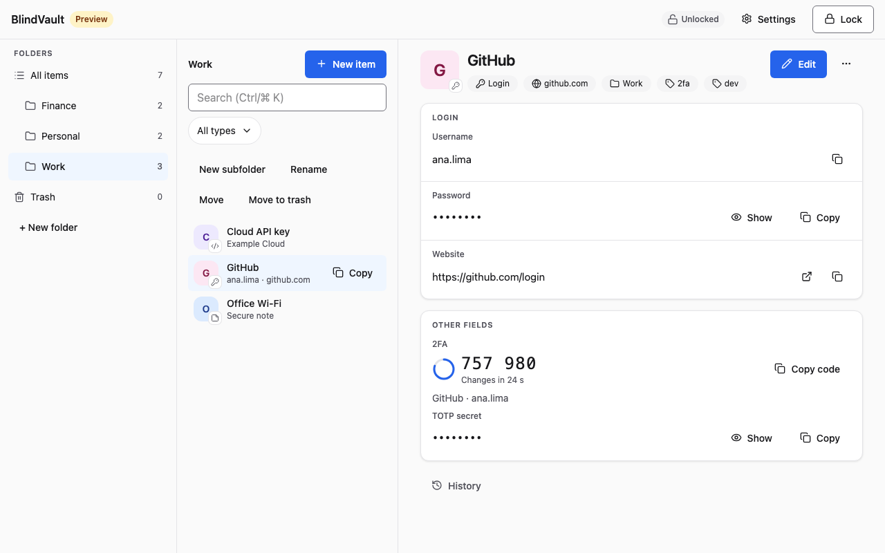
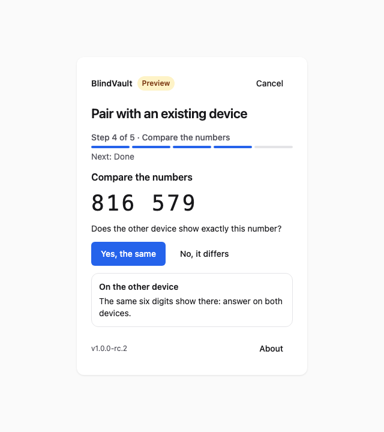
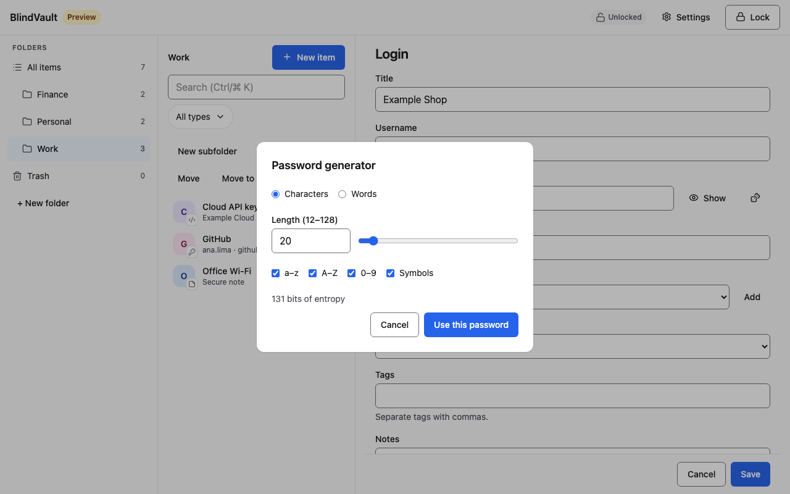
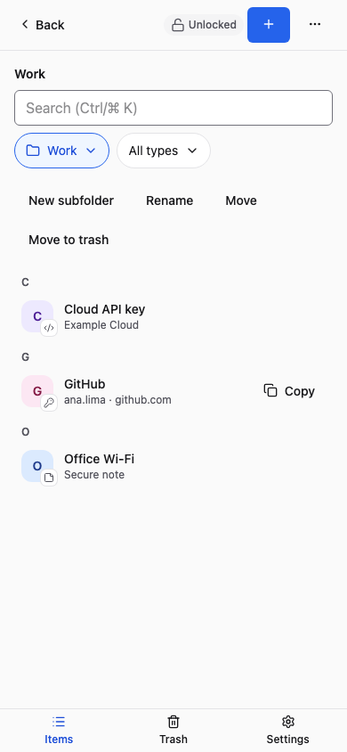
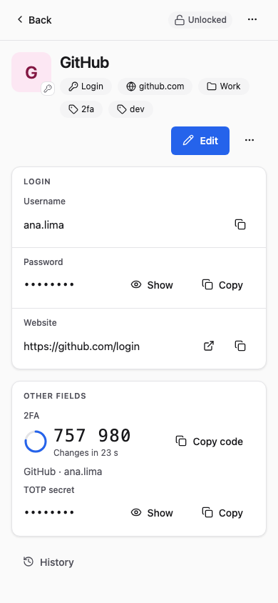

# BlindVault

A local-first, end-to-end encrypted personal vault that runs in the browser. There is no account
and no server that stores your data: the vault lives on your devices and in the encrypted backups
you make, and your devices sync with each other directly.

**Official build: https://blindvault.allisson.dev**. To serve it yourself, see
[docs/self-hosting.md](docs/self-hosting.md).

> [!WARNING]
> BlindVault is not yet at v1.0 and has had no independent security review. Until 1.0, treat every
> vault as throwaway. Before you use it, read [docs/limitations.md](docs/limitations.md): what it
> cannot protect, and when a vault is lost for good.

<picture>
  <source media="(prefers-color-scheme: dark)" srcset="docs/screenshots/vault-desktop-dark.png">
  
</picture>

## Features

**Your data stays yours**

- No account, no data server, no telemetry. Network use is limited to the app's own files and,
  for device connections, STUN servers you choose, or none in "Same network only" mode.
- Installs as a PWA and works offline.
- Every record is encrypted before it is stored or synced (libsodium, XChaCha20-Poly1305). The
  local password goes through Argon2id calibrated to about one second.
- Unlock with the local password or an unlock passkey (WebAuthn PRF). Auto-lock, and a lock when
  the app stays hidden.

**Sync without a server**

- Devices pair over WebRTC, through a QR code or copied text, and each side confirms the same
  six-digit number before any key is sent (Noise protocol).
- Paired devices sync peer to peer. Each one holds a complete encrypted copy of the vault.
- Retire a lost device, and see when each device last synced.

**In the browser and on Android**

- A browser extension for Chrome 127+ and Firefox 149+ fills logins from its popup or a keyboard
  shortcut.
- An Android app, for Android 14 and later, offers your logins and passkeys to other apps and
  browsers through Credential Manager and autofill, and unlocks with biometrics.
- Store passkeys in items and sign in with them through the browser extension or the Android app.
  The web app shows and syncs them, but cannot sign in with them.
- The extension and the app are devices of the vault like any other: pair them, and they sync with
  the rest.
- Get the extension packages and the Android app from
  [GitHub Releases](https://github.com/allisson/blindvault/releases/latest);
  [docs/android.md](docs/android.md) explains how to install the APK.
- The extension is not yet in the Chrome Web Store or on Firefox Add-ons. Until it is, Chrome loads
  it from the release's zip (`chrome://extensions` › Developer mode › Load unpacked, without
  automatic updates), and Firefox only as a temporary add-on, removed when Firefox restarts, so for
  trying it out only.

**Recovery you control**

- A 24-word Recovery Phrase, confirmed at creation, opens your backups and resets a forgotten local
  password.
- Encrypted `.bvault` backups, opened with the Recovery Phrase or an optional export password, with
  a reminder after 30 days. Restore one on a new device, or merge one into a vault.
- If a key may be compromised, re-found the vault: the same items under entirely new keys.

**A vault, not only a password manager**

- Seven templates: Login, Secure note, Payment card, Identity, Developer credential, Crypto wallet
  and Document.
- Ten field types, including TOTP with live codes, seed phrases, dates and long text. Add any field
  to any item.
- Attach files of up to 10 MiB to any item. Each file is encrypted on its own, reaches every paired
  device and goes into your backups.
- Nested folders, tags, search, item history and a trash kept for 30 days.
- Password generator: random characters or BIP39 words, with the entropy shown in bits.
- Secrets stay masked until you reveal them. A copied secret is cleared from the clipboard after
  30 seconds, when the browser allows it.
- Import from Bitwarden, 1Password, LastPass, Dashlane, Proton Pass, KeePassXC, Apple Passwords,
  Chrome and BlindPass.

**Made for every screen**

- Mobile, tablet and desktop layouts, chosen by window width.
- Light and dark themes, six accent colors, English and Brazilian Portuguese.
- WCAG 2.2 AA, checked with axe-core on every screen in both themes.

**Verifiable**

- Reproducible builds: rebuild from source and compare with the published hashes
  ([docs/build.md](docs/build.md)).
- Updates are applied only after you confirm them.
- Few dependencies, pinned exactly, with no install scripts.

## Screenshots

<table>
  <tr>
    <td width="50%">
      <picture>
        <source media="(prefers-color-scheme: dark)" srcset="docs/screenshots/pairing-dark.png">
        
      </picture>
      <p align="center">Pairing: both devices compare the same number</p>
    </td>
    <td width="50%">
      <picture>
        <source media="(prefers-color-scheme: dark)" srcset="docs/screenshots/generator-dark.png">
        
      </picture>
      <p align="center">The password generator</p>
    </td>
  </tr>
  <tr>
    <td width="50%" align="center">
      <picture>
        <source media="(prefers-color-scheme: dark)" srcset="docs/screenshots/list-mobile-dark.png">
        
      </picture>
      <p align="center">Mobile: a folder</p>
    </td>
    <td width="50%" align="center">
      <picture>
        <source media="(prefers-color-scheme: dark)" srcset="docs/screenshots/item-mobile-dark.png">
        
      </picture>
      <p align="center">Mobile: an item</p>
    </td>
  </tr>
</table>

The screenshots follow your system theme. They show made-up data, and
`pnpm --filter @blindvault/web screenshots` takes them again.

## Development

Node `26.13.0` (`.nvmrc`) and pnpm `10.33.0`, through corepack:

```sh
corepack enable pnpm
pnpm install --frozen-lockfile
pnpm --filter @blindvault/web dev    # dev server
pnpm run ci                          # lint, typecheck, format and tests, as CI runs them
pnpm test:e2e                        # Playwright on Chromium, Firefox and WebKit
```

[AGENTS.md](AGENTS.md) lists every command and the repository layout.

## Design and review

The design is written down before the code, and review of it is welcome. Start with the overview,
which prevails over every other document:

- [docs/overview.md](docs/overview.md): architecture, cryptography, protocols, invariants and the
  decision log (section 21).
- [docs/threat-model.md](docs/threat-model.md): what BlindVault defends against, and what it does not.
- [docs/crypto-spec.md](docs/crypto-spec.md): primitives, key hierarchy, AAD and record encryption.
- [docs/pairing-protocol.md](docs/pairing-protocol.md): pairing two devices over WebRTC with Noise
  and a SAS.
- [docs/sync-protocol.md](docs/sync-protocol.md): reconnection and sync between paired devices.
- [docs/backup-format.md](docs/backup-format.md): the encrypted `.bvault` backup file.
- [docs/record-content.md](docs/record-content.md): what an encrypted record holds.
- [docs/attachments.md](docs/attachments.md): how a file attached to an item is encrypted, synced
  and backed up.
- [docs/extension.md](docs/extension.md): the browser extension, filling and stored passkeys.
- [docs/android.md](docs/android.md): the Android app, its credential provider and autofill.
- [docs/security-invariants.md](docs/security-invariants.md): each invariant and the tests that
  cover it.
- [docs/build.md](docs/build.md): the reproducible build and the asset manifest.
- [docs/roadmap.md](docs/roadmap.md): what comes next. What remains before v1.0 is one external
  review of the whole app.
- [GLOSSARY.md](GLOSSARY.md): the domain terms.

Send design findings and questions as GitHub issues. Report a vulnerability privately, as
[SECURITY.md](SECURITY.md) explains.

## License

[MIT](LICENSE).
